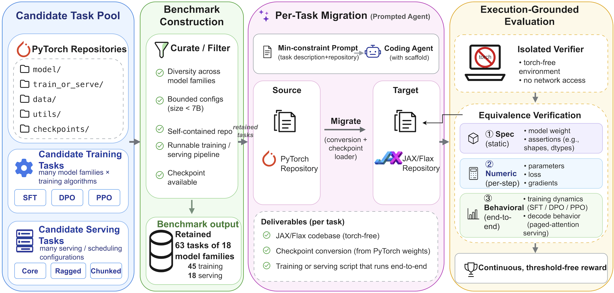

<h1 align="center">T2J-BENCH</h1>

<p align="center">
  <a href="https://arxiv.org/abs/2605.29054"></a>
  <a href="https://ft2023.github.io/T2j-web/"></a>
  <a href="https://huggingface.co/buckets/jiefengcgg/t2j-bench"></a>
  <br>
  <a href="#requirements"></a>
  <a href="#quick-start"></a>
  <a href="CONTRIBUTING.md"></a>
  <a href="LICENSE"></a>
</p>

T2J-BENCH evaluates whether coding agents can migrate a PyTorch repository to native,
torch-free JAX/Flax while preserving its numerical and end-to-end behavior. Each task
provides source code and a raw checkpoint; the agent produces `jax_repo/`, and a separate,
offline verifier compares it with frozen references from the PyTorch implementation.

The release contains **63 tasks**:

| Task class | Instances | Naming | Target implementation |
| --- | ---: | --- | --- |
| Training | 45: 15 models × SFT, DPO, PPO | `{sft,dpo,ppo}_{model}` | `flax.linen` + `optax` |
| Inference | 18: 6 families × 3 serving modes | `{core,ragged,chunked}_{family}` | JAX + `flax.nnx` |



## Start here

1. [Prepare the host](#requirements).
2. [Fetch the frozen references and build one task](#quick-start).
3. [Run an agent](#running-an-evaluation).
4. [Inspect the reward and diagnostics](#reading-results).

To inspect the code, you do not need a GPU or the large reference artifacts. To build
verifier images or grade a candidate, you need the references and model weights.

## Requirements

Use a Linux host with Docker, NVIDIA Container Toolkit, Docker Compose v2, Bash 4+, GNU
coreutils, and `flock`. Verify GPU access with `docker run --gpus all` before building.
Install [Git LFS](https://git-lfs.com/), Python 3.10+ for the host tools, and
[uv](https://docs.astral.sh/uv/) for the Harbor CLI.

### Benchmark configuration

The released evaluation uses the following per-task configuration. The runner and
inference verifier enforce the pinned GPU configuration; using another GPU requires
updating those checks and validating the frozen references on that device.

| Resource | Per task |
| --- | --- |
| GPU | 1 × NVIDIA H100 80GB HBM3 (SXM) |
| CPU | 24 cores |
| RAM | 200 GiB (`memory_mb = 204800`) |
| Agent timeout | 3 hours |
| Verifier timeout | 1 hour |

### Storage and parallel runs

Allow disk space for:

- Frozen references: approximately **19 GiB** checked out, plus **14 GiB** of unique
  objects in `.git/lfs/objects`.
- Model weights: approximately **105 GB** for the 15 training models, plus the
  inference-only models. Weights are included in Docker images.
- Docker layers, agent outputs, and evaluation logs.

Each simultaneous trial needs its own GPU and CPU/RAM allocation. The runner serializes
unassigned GPU trials with a host lock. To use a specific GPU, set
`T2J_GPU_DEVICE_IDS`; coordinate device assignments yourself when running in parallel.

## Quick start

Start with `dpo_bloom`, which does not require access to a gated model.

```bash
# Clone without downloading the large reference artifacts during checkout.
GIT_LFS_SKIP_SMUDGE=1 git clone https://github.com/google-research/t2j-bench.git
cd t2j-bench

# Install the supported Harbor version and the host-side data tools.
uv tool install --python 3.12 harbor==0.20.0
python3 -m pip install -U huggingface_hub 'PyYAML==6.0.3'

# Configure the Hugging Face bucket transfer agent and fetch this task's references.
tools/setup_lfs.sh
git lfs pull --include='tasks/dpo_bloom/tests/golden/**'
python3 tools/check_goldens.py tasks/dpo_bloom

# Build the task's base, weight, agent, and verifier images.
./build_harbor_images.sh --with-bases dpo_bloom

# Set your provider credentials in the shell, then run one attempt.
AGENT_ENV=ANTHROPIC_API_KEY ./run_eval.sh dpo_bloom
```

Harbor requires Python 3.12 or newer and is pinned to **0.20.0** because `tools/patch_harbor.py` applies version-specific
GPU allocation and artifact-scrubber patches. `run_eval.sh` applies them idempotently
and checks that they took effect. Upgrade Harbor only after updating and validating
these patches.

For a gated checkpoint such as Gemma, Llama, or PaliGemma, obtain access on Hugging Face
and configure `HF_TOKEN`, `HF_TOKEN_FILE`, or the normal Hugging Face token file before
building. Tokens are passed to the weight build as BuildKit secrets. See
[base_image/README.md](base_image/README.md) for base tiers and host-side weight setup.

### Frozen references

`tasks/<task>/tests/golden/` contains the reference inputs, outputs, gradients, and
trajectories. Git stores LFS pointers; the object bytes are in the public
[Hugging Face bucket](https://huggingface.co/buckets/jiefengcgg/t2j-bench).
Public downloads do not need a token.

```bash
git lfs pull                                      # all tasks
git lfs pull --include='tasks/core_llama3/tests/golden/**'  # one inference task
```

Run `tools/setup_lfs.sh` once per clone. It configures `tools/lfs_hf_bucket.py` as the
repository's local Git LFS transfer agent. Download references **before** building
verifier images: each verifier includes its own copy, so fetching newer files also
requires rebuilding the corresponding image.

`tools/check_goldens.py` checks the task manifest and rejects unresolved LFS pointers.
Its exit codes are `0` for complete data, `1` for missing data, and `2` when the
configuration or dependencies prevent the check. If the host lacks PyYAML, the shell
scripts print a warning and use a weaker presence check; install PyYAML for the full
check. Set `GOLDEN_PYTHON` if these tools use a separate Python environment.

## Running an evaluation

```bash
./run_eval.sh [TASK] [-- extra Harbor flags...]

AGENT_ENV=ANTHROPIC_API_KEY ./run_eval.sh dpo_bloom
AGENT_ENV=ANTHROPIC_API_KEY ./run_eval.sh core_llama3
AGENT_ENV=ANTHROPIC_API_KEY MODEL=claude-sonnet-5 ./run_eval.sh sft_qwen2
./run_eval.sh dpo_bloom -- --debug
```

The default task is `dpo_bloom`. The agent runs in a networked GPU container and writes
`/workspace/jax_repo`. Harbor transfers that artifact to a separate, torch-free,
no-network verifier, which runs the task's `tests/test.sh` and writes `reward.json`.
Model weights are already in both images under `/data/{repo_id}`.

| Variable | Default | Purpose |
| --- | --- | --- |
| `AGENT` | `claude-code` | Harbor agent |
| `MODEL` | `claude-opus-5` | Agent model |
| `AGENT_ENV` | Empty | Comma- or space-separated host variable names to forward |
| `N_CONCURRENT` | `1` | Harbor trial concurrency |
| `MAX_RETRIES` | `1` | Retries for transient trial errors |
| `JOBS_DIR` | `jobs` | Output directory |
| `GOLDEN_PYTHON` | Authoring venv if present, otherwise `python3` | Manifest-check interpreter |
| `T2J_GPU_DEVICE_IDS` | Unset | Comma-separated GPU IDs for this invocation |
| `LOCKDIR` | `/tmp/t2j-jaxtrain-gpu.locks` | Host GPU lock directory |
| `T2J_ALLOW_CONCURRENT` | `0` | Bypass the host lock; caller manages GPU exclusivity |

### Agent credentials

The runner supplies no provider credentials. Container-side agents such as `claude-code`
need their credential variables forwarded through `AGENT_ENV`. Host-side LiteLLM
agents such as `terminus-2` read the host environment directly.

```bash
# Direct Anthropic credentials, already exported in your shell.
AGENT_ENV=ANTHROPIC_API_KEY ./run_eval.sh dpo_bloom

# Gateway credentials, already exported in your shell.
AGENT_ENV='ANTHROPIC_BASE_URL,ANTHROPIC_AUTH_TOKEN' ./run_eval.sh dpo_bloom

# Host-side model calls use the provider's normal environment variables.
AGENT=terminus-2 MODEL=gemini-3.1-pro-preview ./run_eval.sh dpo_bloom
```

Forwarded variables become Harbor `--ae NAME=VALUE` arguments. The runner redacts values
in its printed command, but they are present in the running process's arguments.
Harbor's persisted-config scrubber recognizes secret-like variable names containing
`KEY`, `SECRET`, `TOKEN`, `PASSWORD`, `CREDENTIAL`, or `AUTH`; use those names for secrets.

## What is evaluated

Training tasks cover SFT, DPO, and PPO across 15 model families. The agent implements
checkpoint conversion, model computation, gradients, data processing, and real training
steps in JAX/Flax/Optax. Conversion must read the raw checkpoint without importing PyTorch.
The model list and Hugging Face repository IDs are in
[base_image/models.txt](base_image/models.txt).

Inference tasks cover Llama 3, Qwen2, Qwen3, GPT-OSS, Gemma 4, and Qwen2.5-VL.
`core` evaluates a single-sequence paged-cache engine; `ragged` adds requests of different
lengths; `chunked` adds chunked prefill and prefix reuse. Checks cover paged KV caches,
block tables, sampler transforms, and greedy decode.

| Stage | Role | Examples |
| --- | --- | --- |
| Spec | Structural gate | Torch independence, checkpoint conversion, shapes, interfaces |
| Numeric | Continuous fidelity | Logits, module outputs, training losses and gradients |
| Behavioral | Fidelity and invariants | Training trajectories, masking, deterministic decode, cache behavior |

For a complete evaluation with both scored dimensions:

```text
reward = spec_pass_rate × (0.5 × numeric_score + 0.5 × behavior_score)
```

`spec_pass_rate` is the fraction of Spec checks that pass. Numeric and behavioral scores
aggregate per-check similarities using a low-tail-sensitive power mean (`p = 0.5`), so
weak checks reduce the dimension score more than an arithmetic mean would. The reducer
renormalizes the equal weights over dimensions with scored checks; no scored dimension
or no passing Spec checks yields zero reward. Binary pass counts are diagnostics, not
the continuous reward.

The verifier is separate from the agent environment, but it executes candidate code.
This release is not a general-purpose sandbox for hostile submissions: the training
verifier runs pytest as root, while the inference verifier drops privileges and protects
the reducer. Candidate-visible artifacts and in-process measurements still require
careful interpretation when evaluating adversarial agents.

## Reading results

```text
jobs/<run>/
├── result.json                       # Job-level results
└── <task>__<id>/
    ├── agent/trajectory.json         # Agent actions
    ├── artifacts/workspace/jax_repo/ # Migrated repository
    └── verifier/
        ├── reward.json               # Reward and diagnostics
        └── test-stdout.txt            # Grader output
```

Read `verifier/reward.json` together with the grader output. A training-task example:

```json
{
  "reward": 0.5325,
  "spec_pass_rate": 0.75,
  "numeric_score": 0.82,
  "behavior_score": 0.60,
  "n_numeric": 21,
  "n_behavioral": 16,
  "overall": 0
}
```

Training tasks also emit flattened per-check similarity keys. Inference tasks use
`numeric_n` and `behavior_n` for dimension counts and include per-stage binary gates,
counts, and `pass_rate`. `overall` and `pass_rate` do not determine the reward.
An inference host/harness precheck failure can produce **no reward file**: inspect the
log before treating an absent grade as a candidate score of zero.

## Grading a candidate without an agent

Use the already-built per-task verifier on the same supported GPU hardware. For example,
to grade the committed training reference:

```bash
mkdir -p out/dpo_bloom
docker run --rm --gpus all --network none \
  -v "$PWD/tasks/dpo_bloom/solution/ref_jax_repo:/workspace/jax_repo:ro" \
  -v "$PWD/out/dpo_bloom:/logs/verifier" \
  --entrypoint bash t2j-verifier:dpo-bloom /tests/test.sh
```

Replace the first mount's source with your candidate's `jax_repo` directory. For an
inference task, use its solution directory and verifier tag, for example
`t2j-inference-verifier:core-llama3`. Task image tags replace the first underscore for
training tasks and every underscore for inference tasks.

## Repository layout

```text
base_image/                 # Shared base/weight images, pins, and model preparation
tasks/<task>/
├── instruction.md          # Agent-facing migration contract
├── task.toml               # Harbor environments, artifacts, and resource limits
├── environment/
│   ├── Dockerfile          # Agent image
│   └── torch_orig/         # Source PyTorch repository
├── tests/
│   ├── Dockerfile          # Verifier image
│   ├── test.sh             # Grading entrypoint
│   ├── test_*.py           # Spec, Numeric, and Behavioral checks
│   ├── _t2j/               # Task-local grader helpers
│   ├── summary_to_reward.py
│   └── golden/             # Git LFS reference artifacts
└── solution/ref_jax_repo/   # Reference JAX implementation; excluded from images
tools/
├── setup_lfs.sh            # Configure bucket-backed Git LFS transfers
├── lfs_hf_bucket.py        # LFS transfer agent
├── check_goldens.py        # Shared build/run manifest check
└── patch_harbor.py         # Supported Harbor compatibility patches
build_harbor_images.sh       # Build task images; --help lists options
run_eval.sh                  # Run an attempt; --help lists usage
```

Task-local helper copies are intentional: each task image must be self-contained.
Keep identical copies synchronized when changing shared grader code. Training and
inference use different JAX/Flax pins; see the [base-image guide](base_image/README.md).

## Citation

```bibtex
@article{t2jbench2026,
  title={T2J-BENCH: Benchmarking Coding Agents on Execution-Grounded PyTorch-to-JAX Repository Migration},
  author={Feng, Tao and Chen, Jiefeng and Song, Linxin and Zhuang, Yufan and Huang, Yue and Mishra, Bhavana Dalvi and Wang, Chi and Tang, Xiangru and Zhao, Jieyu and Liu, Ge and Pfister, Tomas and Yoon, Jinsung},
  journal={arXiv preprint arXiv:2605.29054},
  year={2026}
}
```

## License

Apache 2.0. See [LICENSE](LICENSE) and [CONTRIBUTING.md](CONTRIBUTING.md).

## Disclaimer

This is not an officially supported Google product. This project is not eligible for the
[Google Open Source Software Vulnerability Rewards Program](https://bughunters.google.com/open-source-security).
This project is intended for demonstration purposes only, not production use.
