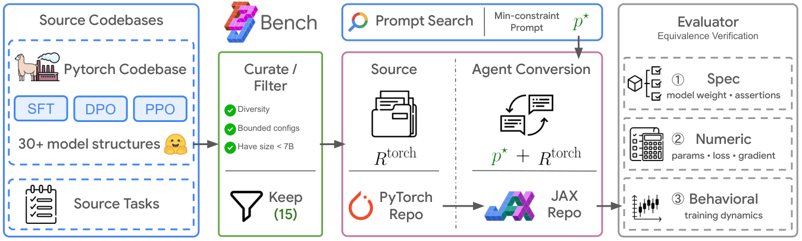

# T2J-Bench

T2J-Bench is a benchmark for semantic-preserving codebase conversion. It tests
whether coding agents can convert LLaMA-Factory-style PyTorch training
repositories into JAX/Flax repositories while preserving the training behavior
that downstream users rely on.

The benchmark accompanies the paper
[**"Converted, Not Equivalent": Benchmarking Codebase Conversion via
Observational Equivalence**](https://arxiv.org/abs/2605.29054). Instead of only
checking whether a converted repository runs, T2J-Bench evaluates each
conversion against a fixed equivalence contract derived from the original
PyTorch codebase.



## At a Glance

- **Task**: convert `torch_orig/` PyTorch training repos into candidate
  `jax_repo/` implementations.
- **Scale**: 45 datapoints = 15 model families x 3 training methods
  (`SFT`, `DPO`, `PPO`).
- **Model families**: `bloom`, `falcon`, `gemma3`, `internvl`, `llama3`,
  `llava_next`, `mistral`, `paligemma`, `phi4`, `qwen2`, `qwen2_omni`,
  `qwen2_vl`, `qwen3`, `qwen3_vl`, and `starcoder2`.
- **Evaluator**: ordered `reference`, `spec`, `numeric`, and `behavioral`
  stages for repo-to-repo observational equivalence.
- **Main launcher**: `bash ./run_interactive_attempt.sh`.
- **Attempt outputs**: `dataset/.attempt_docker/`.

The benchmark focuses on full training-pipeline conversion, not isolated
function translation. Each task gives an agent a PyTorch source repository and a
minimum-constraint prompt. The agent must produce a JAX repository that can be
compared against the source through the fixed external evaluator.


## Repository Layout

| Path | Purpose |
| --- | --- |
| `dataset/{sft,dpo,ppo}/<model>/torch_orig/` | PyTorch source repos used as conversion references. |
| `dataset/instructions/` | Frozen minimum-constraint prompts for SFT, DPO, and PPO tasks. |
| `dataset/eval/` | Staged PyTorch-vs-JAX equivalence evaluator. |
| `coding-agent/` | ADK-based coding-agent scaffold, tools, Docker image files, runner scripts, and tests. |
| `run_interactive_attempt.sh` | Interactive launcher for benchmark attempts and optional evaluation. |
| `call_agent.py` | In-container CLI entry point for ADK-based agents. |
| `requirements.txt` | Host `lf` environment requirements, including CUDA PyTorch/JAX wheels. |

Generated artifacts are intentionally kept out of the source tree:

```bash
dataset/.attempt_docker/
```

## Reference Environment

The benchmark was developed and tested on the system below. Other
configurations may work, but this is the environment used for the reported
results.

| Component | Specification |
| --- | --- |
| OS | Debian GNU/Linux 11 (bullseye) |
| Kernel / Arch | 5.10.0 (cloud) / x86_64 |
| CPU | 2x Intel Xeon @ 2.20GHz (96 vCPUs) |
| Memory | ~1.3 TiB |
| GPU | 8x NVIDIA A100-SXM4-80GB (80 GB each) |
| NVIDIA driver | 550.90.07 (supports CUDA 12.4) |
| Docker | 20.10.17 |
| Python (`lf` env) | 3.11.15 |
| PyTorch | 2.12.0+cu126 |
| JAX | 0.10.1 (CUDA 12) |

Each attempt requests 2 GPUs by default.

## Requirements

The attempt workflow is designed for a Linux or WSL shell with GPU-enabled
Docker. Before running attempts, make sure you have:

- Docker daemon access through either `docker` or `sudo -n docker`.
- NVIDIA Container Toolkit if using GPUs.
- A local conda environment named `lf`.
- `conda-pack` available in that environment.
- Editable source trees used by the Docker image build:
  - `adk-python/src` from this repo's vendored custom ADK fork.
  - `$HOME/LlamaFactory/src` from a separately cloned LlamaFactory checkout.
- Provider credentials for whichever agent you run.
- Hugging Face access for any gated model weights you evaluate.

## Quick Start

Run the following from the repository root.

### 1. Create the Host Environment

LlamaFactory's current `main` requires Python `>=3.11`, so the reference setup
uses Python 3.11.

```bash
conda create -n lf python=3.11 -y
conda activate lf

git clone https://github.com/hiyouga/LlamaFactory.git "$HOME/LlamaFactory"
pip install -e "$HOME/LlamaFactory"

pip install -e ./adk-python

# Install after the editable packages so CUDA 12 torch overrides any default
# torch wheel pulled by LlamaFactory.
pip install -r requirements.txt
```

The evaluator and helper code in `run_interactive_attempt.sh` run on the host,
not inside the attempt container. The launcher automatically prefers an `lf`
environment found under `.conda`, `miniconda3`, or `/opt/conda`. To point it at
a specific interpreter:

```bash
CODING_AGENT_PYTHON_BIN="$HOME/.conda/envs/lf/bin/python" bash ./run_interactive_attempt.sh
```

Create the default agent environment file if you plan to use `client_agent` or
`iterative_agent`:

```bash
cp coding-agent/coding_agent/.env.example coding-agent/coding_agent/.env
```

Then fill in provider settings such as `GOOGLE_CLOUD_PROJECT` and
`CODING_AGENT_MODEL`. For `codex`, `gemini`, and `claude`, the interactive
launcher can also use your shell environment or a custom env file.

### 2. Check CUDA

```bash
python -c "import torch; print(torch.cuda.is_available())"
python -c "import jax; print(jax.devices())"
pip check
```

`torch.cuda.is_available()` should print `True`, `jax.devices()` should show
CUDA devices, and `pip check` should report no broken requirements.

`requirements.txt` pins CUDA 12.6 PyTorch wheels (`torch==2.12.0+cu126`,
`torchvision==0.27.0+cu126`, `torchaudio==2.11.0+cu126`) and installs
`jax[cuda12]`. If your NVIDIA driver needs a different CUDA build, adjust the
PyTorch index URL and `+cuXXX` pins before installing.

### 3. Build the Docker Image

```bash
bash coding-agent/docker/coding_agent_lf/build_image.sh coding-agent-lf:latest
```

The build script packages the host `lf` conda environment, copies editable ADK
and LlamaFactory sources into the Docker build context, and builds
`coding-agent-lf:latest`.

If LlamaFactory or `conda-pack` lives somewhere else:

```bash
CODING_AGENT_LLAMAFACTORY_SRC=/path/to/LlamaFactory/src \
CODING_AGENT_CONDA_PACK_BIN=/path/to/conda-pack \
bash coding-agent/docker/coding_agent_lf/build_image.sh coding-agent-lf:latest
```

### 4. Verify the Image

Quick import check:

```bash
sudo -n docker run --rm \
  --mount type=bind,src="$(pwd)",dst=/opt/t2j_bench,readonly \
  coding-agent-lf:latest \
  bash -lc 'PYTHONPATH=/opt/t2j_bench/coding-agent python -c "import coding_agent, tools; print(\"ok\")"'
```

GPU/JAX check:

```bash
sudo -n docker run --rm --gpus all coding-agent-lf:latest \
  bash -lc 'python - <<'"'"'PY'"'"'
import jax
print(jax.__version__)
print(jax.devices())
PY'
```

Use plain `docker` instead of `sudo -n docker` if your user already has Docker
daemon access.

### 5. Run an Attempt

```bash
bash ./run_interactive_attempt.sh
```

For a small smoke run, choose:

- training method: `sft`
- model: `bloom`
- agent: `client_agent`
- Docker image: `coding-agent-lf:latest`
- pytest evaluation: disabled

The launcher prompts for task/model, agent, env profile, model override, Docker
image, GPU mapping, verbose/yolo mode, optional pytest evaluation, and optional
batch resume settings.

## Hugging Face Access

The evaluator downloads model weights from Hugging Face. Gated models, for
example `google/gemma-3-4b-it` used by `sft/gemma3`, require a token whose
account has accepted the model license.

Attempt containers bind-mount the host `~/.config/gcloud` and
`~/.cache/huggingface` directories, so host authentication is visible inside the
container.

1. Accept the model license on its Hugging Face page while logged in.
2. Log in on the host:

```bash
hf auth login
# or, if the CLI is not on PATH:
conda run -n lf hf auth login
```

Verify access before running an attempt:

```bash
conda run -n lf python -c "from huggingface_hub import whoami; print(whoami()['name'])"
```

Ungated models such as `sft/bloom` do not need a token.

### Pre-download cache-only models

Most references download weights on demand, but `llava_next` uses a cache-only
loader (`snapshot_download(..., local_files_only=True)`), so its model must be
present in the Hugging Face cache beforehand or its reference fails with
`Tokenizer file not found: .../tokenizer.json`. Pre-download it once (it is
ungated; the cache is shared with attempt containers):

```bash
hf download llava-hf/llava-v1.6-vicuna-7b-hf
# or, if the CLI is not on PATH:
conda run -n lf hf download llava-hf/llava-v1.6-vicuna-7b-hf
```

## Running Attempts

### Interactive Launcher

The recommended entry point is:

```bash
bash ./run_interactive_attempt.sh
```

Supported training-method choices are `sft`, `dpo`, `ppo`, and `all`.
Supported top-level agents are `client_agent`, `iterative_agent`, `codex`,
`gemini`, and `claude`.

For `client_agent`, `codex`, `gemini`, and `claude`, the launcher stages an
isolated candidate repository and archives the final candidate as:

```bash
dataset/.attempt_docker/<model>_<task>_<timestamp>/jax_repo/
```

Batch runs write logs under:

```bash
dataset/.attempt_docker/batch_runs/
```

### Direct Docker Runner

For custom automation, call the lower-level runner directly:

```bash
python coding-agent/scripts/run_attempt_in_docker.py \
  --image coding-agent-lf:latest \
  --workspace dataset \
  --mount sft/gemma3:sft/gemma3 \
  --prompt-file dataset/instructions/sft.md \
  --agent client_agent \
  --attempt-root dataset/.attempt_docker/gemma3_sft_manual \
  --gpus device=0,1 \
  --verbose
```

Useful options:

- `--mount RELPATH` mounts selected workspace paths into the container.
- `--prompt` or `--prompt-file` supplies the conversion instruction.
- `--agent` selects `client_agent`, `iterative_agent`, `codex`, `gemini`, or
  `claude`.
- `--gpus none` disables GPU passthrough.
- `--dry-run` prints the Docker command without executing it.

Prebuilt wrappers for selected tasks live in:

```bash
coding-agent/docker/coding_agent_lf/attempt_scripts/
```

Example:

```bash
bash coding-agent/docker/coding_agent_lf/attempt_scripts/run_sft_gemma3.sh
```

## Evaluating a Candidate JAX Repo

The interactive launcher can generate the evaluator config and run pytest for
you. To run evaluation manually, use `dataset/eval`.

Example for an SFT candidate:

```bash
cd dataset/eval

XLA_PYTHON_CLIENT_PREALLOCATE=false CUDA_VISIBLE_DEVICES=0,1 \
python -m lib.generate_config \
  sft \
  ../sft/gemma3/torch_orig \
  ../.attempt_docker/gemma3_sft_manual/jax_repo \
  --config-out configs/local_sft_gemma3.yaml \
  --output-dir outputs/local_sft_gemma3 \
  --no-run

XLA_PYTHON_CLIENT_PREALLOCATE=false CUDA_VISIBLE_DEVICES=0,1 \
python -m pytest -q tests/test_eval_pipeline.py \
  --eval-config configs/local_sft_gemma3.yaml
```

Each evaluation writes:

- `new_eval_report.json`: full staged report with compared artifacts.
- `new_eval_summary.json`: compact pass/fail summary.

Interpret stage failures in order:

1. Fix `reference` before comparing repositories.
2. Fix `spec` before tuning numeric behavior.
3. Treat skipped or missing `behavioral` artifacts as real failures, not
   success.

For evaluator design details, see `dataset/eval/README.md`.

## Adding a New Agent

An "agent" is the system under test. It receives a frozen instruction prompt,
writes a converted JAX repo, and is evaluated externally.

Inside the container, every agent must honor the same contract:

- **Prompt**: the rendered instruction is available under `/attempt_meta/`.
  Treat it as the only task guidance.
- **Workspace**: the working directory is `/attempt_workspace`.
- **Source repo**: the PyTorch reference is mounted at
  `/attempt_workspace/<task>/<model>`.
- **Candidate repo**: the converted repository must be written to
  `/attempt_workspace/jax_repo`.
- **Credentials**: model-provider and Hugging Face credentials are mounted from
  the host environment/profile selected by the launcher.
- **Done condition**: success means a populated `jax_repo/`; the agent does not
  need to return a special value.

There are two common integration paths.

### Option A: External CLI Agent

Use this pattern for an agent that reads a prompt on stdin and edits files in
the current directory, like the existing `codex`, `gemini`, and `claude`
integrations.

1. Install the CLI in `coding-agent/docker/coding_agent_lf/Dockerfile`, then
   rebuild the image.
2. Add `_build_<name>_exec_command(...)` in
   `coding-agent/scripts/run_attempt_in_docker.py`, modeled on the existing
   Codex/Gemini/Claude builders.
3. Add `<name>` to the runner's `--agent` choices and dispatch branch.
4. Add home-directory, settings, or auth mounts if your CLI needs them.

### Option B: In-Process ADK Agent

Use this pattern for a Python agent built on the vendored Google ADK fork, like
`client_agent` and `iterative_agent`.

1. Create a package under `coding-agent/` with an `agent.py` exposing
   module-level `root_agent`.
2. Reuse tools from `coding-agent/tools/` when possible:
   `fs_tools`, `bash_exec`, `lsp_tool`, `todo_tools`, and related helpers.
3. Register the agent in `call_agent.py`.
4. Add the agent to `coding-agent/scripts/run_attempt_in_docker.py`.

Pure-Python agent changes usually do not require a Docker rebuild because
`coding-agent/` is mounted into the container on `PYTHONPATH`. Rebuild only when
you add dependencies to the `lf` environment.

### Expose the Agent in the Interactive Launcher

For either integration path, update `run_interactive_attempt.sh`:

- Add `<name>` to the `Choose top-level agent` menu.
- Add an env-profile/default-model branch if needed.
- Add `<name>` to `agent_uses_staged_jax_repo` so the produced `jax_repo/` is
  archived for evaluation.

Then run it with:

```bash
bash ./run_interactive_attempt.sh
```

## Vendored `adk-python`

`adk-python/` is a vendored fork of
[google/adk-python](https://github.com/google/adk-python), based on
`google-adk` 1.27.2. The coding agent depends on local modifications that are
not part of an official ADK release, so the fork travels with this repo.

Important local changes include:

- Tool-result formatting for model-readable `read_file`, `search`,
  `patch_file`, `lsp`, evaluator, and related tool outputs.
- Large tool-output offloading to workspace files with compact head/tail
  summaries.
- Anthropic/Claude request handling for output tokens, thinking configuration,
  and long streaming final responses.
- Thought-signature preservation gated by `ADK_PRESERVE_THOUGHT_SIGNATURES`.
- Gemini/Vertex client selection from environment/model name.
- Verbose tool-call, result, and usage rendering for attempt logs.
- Minor tweaks to planning, LiteLLM handling, and GCP IAM connector removal.

## Useful Checks

Check shell and Python syntax:

```bash
bash -n run_interactive_attempt.sh
bash -n coding-agent/docker/coding_agent_lf/build_image.sh
python -m py_compile call_agent.py coding-agent/scripts/run_attempt_in_docker.py
```

Inspect the current Docker image:

```bash
sudo -n docker image inspect coding-agent-lf:latest
```

Validate evaluator configs:

```bash
cd dataset/eval
python -m lib.validate_configs
```

## Notes

- Existing attempt outputs can be resumed or skipped when running `all` or all
  models for one task.
- `dataset/eval` is reference-first: `torch_orig` defines the contract, and the
  JAX candidate must match that contract through repo-owned entry points.
- The benchmark verifier is fixed and external to the agent. Agent self-reports
  are diagnostic logs, not benchmark pass/fail labels.

## Citation

```bibtex
@article{song2026converted,
  title={Converted, Not Equivalent: Benchmarking Codebase Conversion via Observational Equivalence},
  author={Song, Linxin and Chen, Jiefeng and Huang, Yue and Mishra, Bhavana Dalvi, and Wang, Chi and Zhao, Jieyu and Yoon, Jinsung and Pfister, Tomas},
  journal={arXiv preprint arXiv:2605.29054},
  year={2026}
}
```

## License

Apache 2.0 License. See [`LICENSE`](LICENSE) for details.

## Disclaimer

This is not an officially supported Google product. This project is not
eligible for the
[Google Open Source Software Vulnerability Rewards Program](https://bughunters.google.com/open-source-security).

This project is intended for demonstration purposes only. It is not intended for
use in a production environment.
